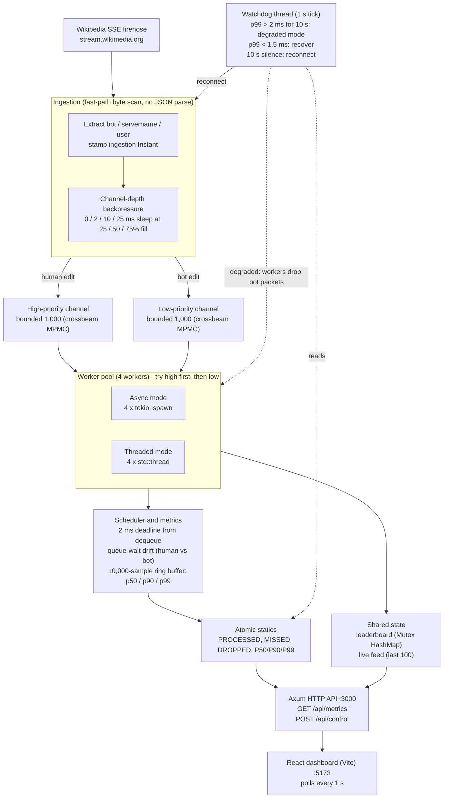
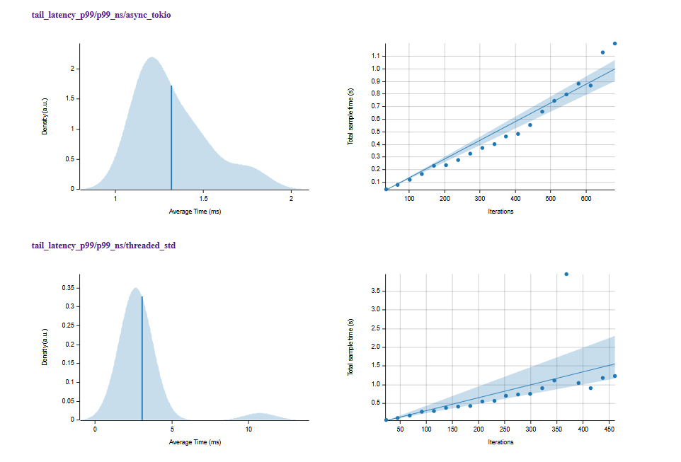

# Wikipedia Real-Time Monitor

A real-time data ingestion and analytics pipeline written in **Rust** that consumes the live Wikipedia *Recent Changes* Server-Sent Events firehose, enforces a **2 ms per-packet processing deadline**, and compares two concurrency models (Tokio async tasks vs OS threads) under bursty, non-deterministic load. A React dashboard shows latency percentiles, scheduling drift, the watchdog state and a live edit feed.

Built for a Real-Time Systems assignment. The full write-up is in [`docs/report.pdf`](docs/report.pdf).

## Highlights

- **Async vs threaded pipelines** with identical channels and scheduling code, so the comparison is fair. Under burst load the async (Tokio) pipeline had a **2.3x lower p99 tail latency** (1.47 ms vs 3.38 ms) at the same throughput (~285 K elem/s).
- **Priority scheduling with measurable drift.** Human edits use a high-priority bounded channel and bot edits a low-priority one. Human edits waited less: **1.38x** in async mode and **1.84x** in threaded mode.
- **Deadline measured correctly.** The 2 ms clock starts when a worker dequeues a packet, not when the event arrived, so queue wait and processing time are reported separately.
- **Zero-copy hot path.** The `user` field is parsed as a `&'a str` that borrows the original `Bytes` buffer. A unit test checks the pointer lies inside the buffer.
- **Watchdog and degraded mode.** If p99 stays above 2 ms for 10 s, workers drop bot packets; recovery happens automatically below 1.5 ms. A silent stream for 10 s triggers a reconnect.
- **Channel-depth backpressure.** Ingestion slows proportionally (2 / 10 / 25 ms sleeps at 25 / 50 / 75% fill), giving zero dropped packets in normal live operation.
- **Synchronisation benchmark** of `Mutex`, `RwLock` and `AtomicU64`, which justifies atomics on all hot-path counters.

## Architecture

GitHub renders this diagram from text, so it stays in sync with the README. Read it top to bottom.



### Design decisions

| Decision | Why |
|---|---|
| Bounded channels, not unbounded | A burst becomes a finite queue wait instead of unbounded growth |
| Two channels, not one priority queue | Workers do a non-blocking `try_recv` on the high channel with no sorting or locking, so a bot packet can never block a human one |
| Deadline from dequeue, not arrival | Under bursts, tail latency is dominated by queue wait; measuring from arrival would confuse waiting with processing |
| Atomics for hot-path counters | Lock acquisition on every packet would be the bottleneck (see benchmark below) |
| `Mutex` on the leaderboard | Writes happen at event rate (about 50-150/s) and it gives a clear point of comparison |

## Results

All measurements: Intel Core Ultra 7 155H (16 cores, 22 logical processors), Windows 11, live Wikipedia stream or Criterion.rs.

### Synchronisation primitives (1,000,000 increments)

| Primitive | Elapsed | Ops/sec | ns/op |
|---|---|---|---|
| Mutex | 55.08 ms | 18,155,344 | 55.1 |
| RwLock | 41.24 ms | 24,250,714 | 41.2 |
| AtomicU64 | 12.21 ms | 81,875,942 | 12.2 |

`AtomicU64` was 4.5x faster than `Mutex` and 3.4x faster than `RwLock` in this sweep. In the Criterion micro-benchmark the per-operation cost was 4.20 ns (atomic) vs 9.93 ns (mutex), about 2.4x. The `RwLock` Criterion figure (341.58 ns) was very noisy under the Windows scheduler and should not be taken as representative.

### Async (Tokio) vs threaded under burst load (Criterion)

| Metric | Async | Threaded | Async std dev | Threaded std dev |
|---|---|---|---|---|
| p99 tail latency | **1.47 ms** | 3.38 ms | 193 µs | 1.82 ms |
| Mean latency | **1.14 ms** | 1.90 ms | 128 µs | 150 µs |
| Median latency | **1.09 ms** | 1.86 ms | 64 µs | 138 µs |
| Throughput (1,000 pkts) | 286.69 Kelem/s | 284.35 Kelem/s | - | - |

Throughput is equal (difference under 1%); async only improves **tail latency and jitter**. Under sustained burst the threaded p99 exceeds the 2 ms deadline while async stays under it.



### Live system, normal operation (about 3,000 events after warm-up)

| Metric | Async | Threaded | Target |
|---|---|---|---|
| p50 processing latency | 0.02 ms | 0.02 ms | - |
| p90 processing latency | 0.04 ms | 0.04 ms | - |
| p99 processing latency | 0.11 ms | 0.16 ms | 2.00 ms |
| Missed deadlines | 3 | 5 | 0 |
| Dropped packets | 0 | 0 | 0 |
| Throughput | 45.8 edits/s | 35.1 edits/s | - |
| Human avg queue wait | 0.16 ms | 0.31 ms | - |
| Bot avg queue wait | 0.22 ms | 0.57 ms | - |
| Priority ratio (bot / human) | 1.38x | 1.84x | > 1.0x |

Fault tolerance: during a bot-heavy burst on `commons.wikimedia.org`, the watchdog entered degraded mode (3,752 packets dropped, 284 deadlines missed), then flushed the ring buffer and returned to normal automatically once p99 fell below 1.5 ms.

## Getting started

Prerequisites: Rust (stable) and Node.js.

```bash
# 1. Backend: connects to Wikipedia, serves the API on :3000
cargo run --release

# Optional: run the Mutex / RwLock / Atomic benchmark first
cargo run --release -- --benchmark

# 2. Dashboard (second terminal)
cd frontend
npm install
npm run dev          # open http://localhost:5173
```

```bash
cargo test           # unit and integration tests
cargo bench          # Criterion: sync primitives and async vs threaded
```

## Project structure

```
src/
  ingestion.rs   SSE client, fast-path parsing, backpressure
  processing.rs  zero-copy ProcessedPacket<'a>
  pipeline.rs    async and threaded worker pools, global counters
  scheduling.rs  deadline, queue-wait drift, percentile ring buffer
  watchdog.rs    degraded mode and network-silence recovery
  metrics.rs     synchronisation benchmark
  gui.rs / gui_state.rs   Axum API and shared state
frontend/        React + Vite dashboard
benches/         Criterion benchmarks
tests/           integration tests
docs/            report and figures
```

## Limitations and future work

- Soft real-time: a missed deadline increments a counter rather than failing the system.
- Numbers come from one Windows laptop; results on other hardware or a real-time kernel will differ.
- Future work: token-bucket ingestion control, Prometheus export for long-term latency analysis, and testing under Linux PREEMPT_RT.

## Author

<YOUR NAME> - <email / LinkedIn>
